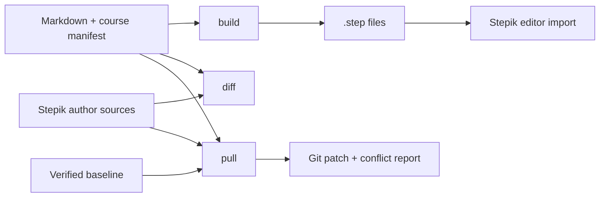
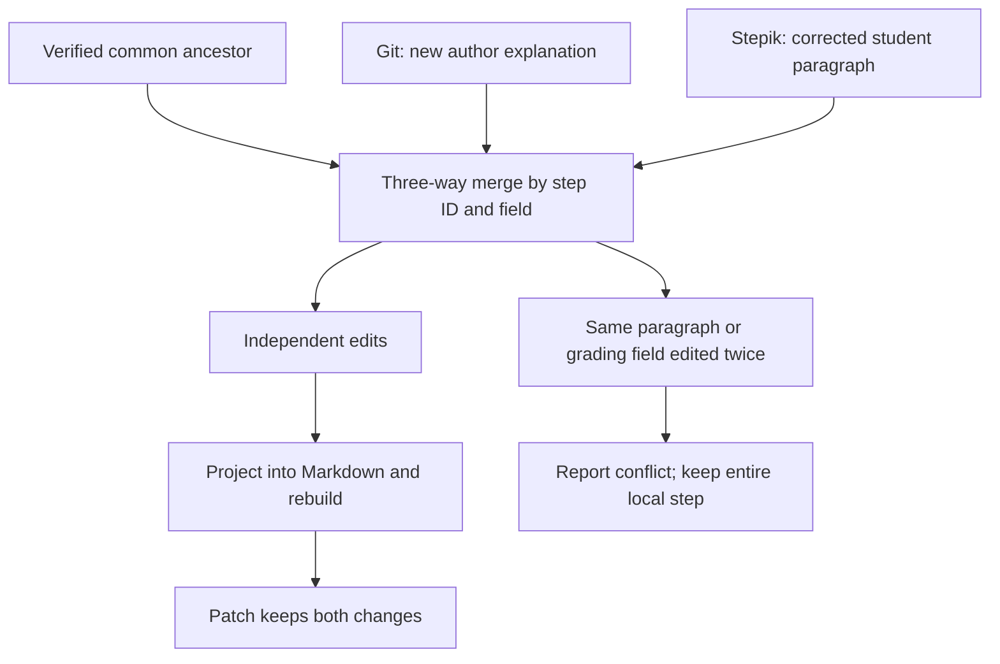
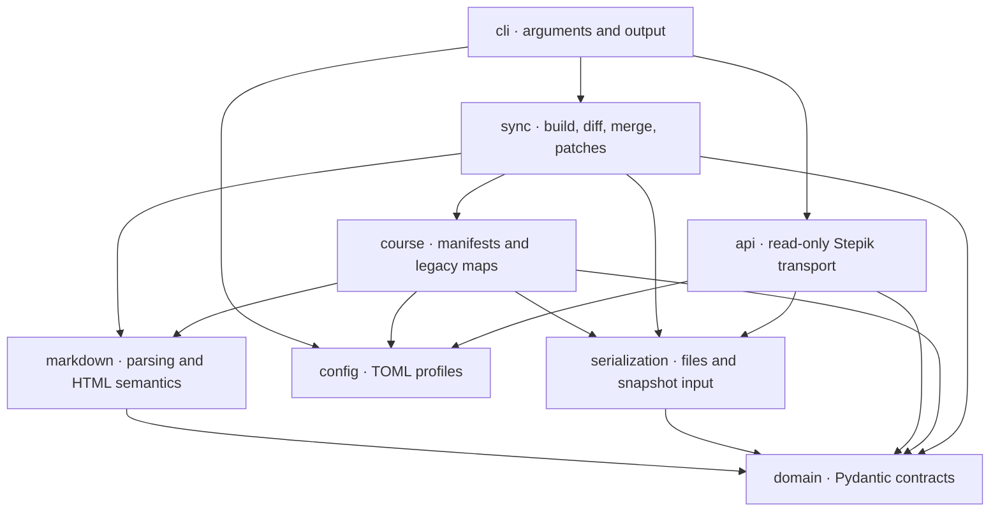
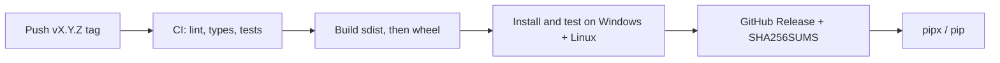

# stepik-author-tools

**Keep Stepik lessons and Git sources in sync — without losing author notes.**

[](https://github.com/galua-study/stepik-author-tools/actions/workflows/ci.yml)
[](https://github.com/galua-study/stepik-author-tools/actions/workflows/cd.yml)

[](LICENSE)

A Python library and CLI for course authors: compile Markdown into `.step` imports,
review meaningful differences, and prepare a Git patch from edits made on Stepik.
Version 0.1 supports text, single choice, multiple choice, matching, and local
self-check exercises. Network operations are read-only.

[Quick start](#quick-start) · [Authoring](#authoring) · [Configuration](#configuration) · [Synchronization](#synchronization) ·
[Architecture](#architecture) · [Library](#python-library-and-future-mcp) · [Releases](#installation-and-releases)



| Command | Result | Source changes |
| --- | --- | --- |
| `build` | Ordered `.step` files, index, local snapshot | None |
| `diff` | Changes to text/code, options, keys, pairs, settings, and positions | None |
| `pull` | Reviewable Git patch and conflict report | None; apply the patch yourself |

## Quick start

Requires Python 3.11+ and Git. This PowerShell example uses a **synthetic course**;
no account or token is needed.

```powershell
git clone https://github.com/galua-study/stepik-author-tools.git
cd stepik-author-tools
py -3 -m venv .venv
.\.venv\Scripts\python.exe -m pip install .
.\.venv\Scripts\Activate.ps1

stepik-author build examples/demo --out out/import
stepik-author diff examples/demo --remote examples/demo/remote-edited.json
stepik-author pull examples/demo --remote examples/demo/remote-edited.json --base examples/demo/baseline.json --out out/review.patch
```

On Linux/macOS use `python3 -m venv .venv` and `source .venv/bin/activate`.
If PowerShell activation is restricted, call `.\.venv\Scripts\stepik-author.exe` directly.

The demo builds **seven steps**. Diff reports a changed question, a changed answer
key, a changed Python line, and moves between positions 5 and 6. Pull proposes
changes to three files while preserving the local author explanation.
The demo IDs are fictional; use these fixtures only with `--remote`.

Inspect `out/review.patch` and `out/review.patch.json`, then apply:

```powershell
git apply --check --directory=examples/demo out/review.patch
git apply --directory=examples/demo out/review.patch
stepik-author diff examples/demo --remote examples/demo/remote-edited.json
```

The final diff should be empty. Paths in the patch are relative to the course root.
Generated outputs must not alias course sources, the manifest, or CLI input files.
Such collisions are rejected before writing. Patches retain UTF-8 BOMs and existing
line endings, including unchanged lines in files with mixed endings.
Git uses `a/` for the old version and `b/` for the new version. By default,
`git apply` strips that first path component. Omit `--directory` when the course
root is also your Git root. [Git patch path handling](https://git-scm.com/docs/git-apply)

| Exit code | `build` | `diff` | `pull` |
| --- | --- | --- | --- |
| `0` | Built | Equal | Prepared without conflicts |
| `1` | — | Differences found (expected in the demo) | Conflicts need review |
| `2` | Invalid input or access error | Invalid input or access error | Invalid input or access error |

## Authoring

[`examples/demo`](examples/demo) is a complete source-format reference.
The [demo manifest](examples/demo/course.json) declares modules, topics, and ordered steps.
Pass a JSON manifest by any filename. Given a directory, the tool checks the
preferred filename (default `course.json`), then looks for a single JSON object
with `version` and `topics`. Snapshots and baselines can live beside it. If two
manifests match, supply a file path or set `project.manifest_name`. A directory
without a manifest uses the topic-map adapter.

```json
{
  "version": 1,
  "topics": [
    {
      "id": "values",
      "module": "module-1",
      "lesson_id": 900001,
      "steps": [
        {"id": "welcome", "stepik_id": 910001, "path": "welcome.md"}
      ]
    }
  ]
}
```

Array order defines step order. Use `--scope values` for one topic or
`--scope module-1` for a module. Paths stay inside the course root; IDs and source
file ownership must be unique. `paths` can combine several text introductions.

Stable `stepik_id` values identify steps across moves. Obtain the real IDs after
import from `GET /api/lessons/{id}` and the corresponding `step-sources`, then
record the mapping. The `/step/4` suffix in a lesson URL means **position**, not
identity. Synchronization never guesses identities from positions or similar text.
Build can run before platform IDs are assigned.

| Markdown section | Destination |
| --- | --- |
| `### Condition` / `### Условие` | Student-facing content |
| `### Options` / `### Варианты ответа` | Ordered choice options |
| `### Correct answer(s)` / `### Правильный ответ` / `### Правильные ответы` | Grading key in `block.source` |
| `### Explanation` / `### Объяснение` | Kept locally for the author |
| Reference solutions and transfer notes | Kept locally for the author |

Number choices consecutively from 1. Matching right-column labels must be unique.
Answer keys can be `2. explanation`, `1, 3`,
or numbered bullet entries. Explicit `multiple` / `несколько` metadata supports
multiple choice with one correct option. Matching uses numbered `Left column` /
`Левая колонка`, lettered `Right column` / `Правая колонка`, and keys like `1 — B, 2 — A`.

Self-check tasks become text steps, with instructions visible and solutions kept
local. Feedback stays empty. Tables, lists, HTML, fenced code, and option order
are preserved. Relative asset links are retained; images are not uploaded.

An adapter also reads existing Russian topic/module README tables, including
combined introductions and numeric topic ordering. Use an explicit manifest for
synchronization. Programming, text-entry, sorting, and custom matching layouts
outside this format fail with an error.

## Configuration

All three commands accept an explicit TOML file. A profile can add headings,
change exercise or legacy-map syntax, translate diff messages and configure
read-only API requests. Each course carries its own settings through compilation,
comparison and patch generation. The [packaged defaults](src/stepik_author_tools/config/defaults.toml)
list the available keys and named regex groups.

```toml
[project]
manifest_name = "syllabus.json"

[markdown]
condition = ["Question"]

[markdown.author_sections]
explanation = ["Author notes"]
review = ["Editorial review"]

[markdown.patterns]
option_heading = '(?m)^Item (?P<number>\d+):[ \t]*\r?\n'

[diff.fields]
answers = "Изменился правильный ответ"

[api]
max_pages = 200
timeout = 15
```

```powershell
stepik-author diff examples/demo --config author.toml --remote examples/demo/remote-edited.json
```

Heading aliases extend the bundled English and Russian names. Every heading in
`markdown.author_sections` ends student-facing content. Other settings override
their defaults. If you change grading syntax, pair the input patterns with the
output templates under `markdown.format` so pulled edits use the same notation.
The tool checks pattern groups when loading the profile and rebuilds each edited
step before emitting a patch. CommonMark handles headings and fenced code.

The `api` table also sets `base_url` and the allowed resource names. The client
uses the process's `STEPIK_TOKEN` only for the official HTTPS origin. Library
callers can pass a separate token explicitly for their own endpoint.

## Synchronization

An offline `--remote` file can contain a version-1 snapshot or a complete
`{"step-sources": [...]}` author API export. Include all steps from the selected
lessons, stable IDs, positions, and grading data. Missing steps are reported;
student-visible `steps` responses cannot substitute for author answer keys.
An exported API page with `meta.has_next = true` is rejected as incomplete.

For live reads, set `STEPIK_TOKEN` in your process to an OAuth bearer token with
author access. Keep credentials out of manifests and command arguments.

```powershell
stepik-author diff path/to/course.json --scope module-1 --live
# Save a common ancestor only after local and remote sources agree:
stepik-author diff path/to/course.json --live --save-baseline .stepik/base.json
# After subsequent changes on either side:
stepik-author pull path/to/course.json --live --base .stepik/base.json --out out/review.patch
```

`diff --json` returns structured changes. HTML normalization ignores editor
IDs/classes and harmless wrappers while preserving links, styling, structure, and
literal code whitespace. Correct answers, matching pairs, and moves are compared
separately from student text.

### How pull protects concurrent edits



Separate paragraph changes can merge. Code blocks, option lists, keys, and pairs
are atomic; incompatible edits conflict. A conflicting question keeps its entire
local content and key. Unrelated steps may still appear in the proposed patch.
Choice options and their numeric answer key are merged as one unit: a key from
Stepik must not be attached to independently changed local options (or vice versa).
In the JSON conflict report, `field` identifies the part that needs attention
(such as `body`, `settings` or `order`), and `reason` explains the conflict.

Changed student content is retained as raw HTML inside Markdown, preserving the
platform formatting. Author sections stay intact. Each proposed material is
recompiled and checked against the intended merged result before it enters a patch.
Within-topic moves update the manifest; incompatible concurrent reorders conflict.

Settings without a Markdown representation, step type changes, additions,
deletions, cross-topic moves, edited task titles, and combined-source edits need
manual review. Pull requires a verified baseline. Build never advances it.
After applying and reconciling changes, save a new baseline only after a zero diff.
A scoped baseline contains only that scope; keep it sufficient for the next pull.

## Architecture

Implementation lives under `src/stepik_author_tools`; tests mirror the same packages
under `tests/stepik_author_tools`. Dependencies point toward the domain contracts.



| Package | Responsibility |
| --- | --- |
| `domain` | Strict Pydantic models for manifests, API envelopes, snapshots, and results |
| `config` | Packaged TOML defaults, per-course overrides and validation |
| `serialization` | UTF-8 file I/O and Pydantic decoding of snapshots and Stepik exports |
| `markdown` | Student/author section boundaries, grading syntax, HTML normalization |
| `course` | Manifest discovery, source path containment, identity checks and ordered compilation |
| `sync` | Semantic comparison, three-way merging, projection, ordering, Git patches |
| `api` | Injectable GET transport, pagination, complete author snapshots |
| `cli` | Argument parsing and presentation of library results |

Pydantic validates nested data at input boundaries without coercing strings or
booleans into IDs. Unknown manifest fields are rejected. Unknown Stepik source
settings remain visible to comparison and serialization. Omitted optional fields
stay omitted on export. Result models prevent attribute reassignment.

Pull orchestration is separated into `semantic.py` (identity/normalization),
`merge.py` (pure merge rules), `projection.py` (section edits and semantic round
trip), `ordering.py` (manifest order), and `patches.py` (patch rendering).
The API and synchronization packages do not depend on one another.

## Python library and future MCP

```python
from stepik_author_tools import (
    build, compare, load_course, load_settings, prepare_pull, read_snapshot,
)

settings = load_settings()  # Pass a TOML path to use a custom profile.
course = load_course("examples/demo", settings=settings)
compiled = build(course, "out/import")
remote = read_snapshot("examples/demo/remote-edited.json")
changes = compare(course, remote, scope="module-1")
proposal = prepare_pull(course, remote, read_snapshot("examples/demo/baseline.json"))

print(compiled.steps[0].block.name)
print(proposal.patch)
print([conflict.model_dump(mode="json") for conflict in proposal.conflicts])
# For live reads, use StepikClient(settings=settings.api).snapshot(course, scope="module-1").
```

Library records are Pydantic models. Access `snapshot.steps` for validated rows.
Semantic step kinds and report fields are string enums in Python and serialize
to stable JSON strings such as `"choice"` and `"answers"`. Use `model_validate_json()`
to read wire data and `model_dump(mode="json", exclude_unset=True)` to export it.
CLI arguments and `.step`/snapshot JSON formats remain compatible; the old
internal top-level facade modules have been removed. The package ships `py.typed`.

A future MCP adapter can call the same operations for:
**“Compare the first module with the draft on Stepik and prepare a patch.”**
(*«Сравни первый модуль с черновиком на Stepik и подготовь патч».*)
The sequence is resolve scope → read author sources → compare → prepare a patch.
The library runs independently of the CLI; MCP transport and REST writes are future work.

## Installation and releases

For daily CLI use, [pipx](https://pipx.pypa.io/stable/) installs the application in
its own environment. Until the first release is published, install the current Git version:

```powershell
py -m pip install --user pipx
py -m pipx ensurepath
# Open a new terminal after ensurepath.
pipx install git+https://github.com/galua-study/stepik-author-tools.git
```

Tagged releases will provide a wheel, source archive (including the demo), and
`SHA256SUMS` on [GitHub Releases](https://github.com/galua-study/stepik-author-tools/releases).
Download the wheel and install it with `pipx install ./downloaded-package.whl`.
Library consumers can install the same wheel with `python -m pip install`.
Python 3.11+ is required; there is no standalone executable in this version.



Maintainers update `project.version` in `pyproject.toml`, commit it, then push a
matching `vX.Y.Z` tag. CD refuses mismatched versions and publishes only after
checks pass. Run **Actions → CD → Run workflow** for a dry run: packages become
workflow artifacts, and no release is created. CI is reused by CD; release write
permission is limited to the publishing job. No PyPI credentials are needed.
A later PyPI channel can use Trusted Publishing once the project name and ownership
are configured; it would publish the same tested distributions.

Release-specific Python logic lives in `.github/scripts/`; workflows orchestrate these
commands alongside the standard setup and artifact actions. Run the same checks
locally from the repository root (or an extracted source archive):

```powershell
python .github/scripts/check_release_tag.py v0.1.0
python -m build
python .github/scripts/write_checksums.py dist
# In a fresh virtual environment:
python .github/scripts/install_distribution.py '*.whl' --directory dist
python .github/scripts/verify_install.py
```

`check_release_tag.py` also accepts `RELEASE_TAG`, and `install_distribution.py`
accepts `DISTRIBUTION`, for shell-independent CI calls. Checksum generation includes
only `.whl` and `.tar.gz` files and can be repeated safely. `verify_install.py`
rejects editable/source-tree imports so delivery tests exercise the built package.
These scripts are included in the source archive and checked by Ruff and mypy.

## Development and verification

Activate the project's virtual environment, then run from the repository root:

```powershell
python -m pip install -e '.[dev]'
python -m ruff check .
python -m ruff format --check .
python -m mypy
python -m pytest -q
```

These commands work on Windows, Linux and macOS. CI runs the same Ruff lint/format
checks, strict mypy with the Pydantic plugin, and pytest. It covers Python 3.11–3.13
on Windows and Ubuntu, plus minimum runtime
dependencies. Tests use synthetic data and injected HTTP transport. They exercise
actual patch application, concurrent edits, output contracts, and the installed
CLI. Course Markdown is excluded from code formatting.

| Evidence | Verified boundary |
| --- | --- |
| Offline tests | All three commands; grading/privacy; formatting and code; identities/moves; successful merges and conflicts; strict models; mocked pagination/access failures |
| Clean installation | Wheel installation, dependency check, demo commands, and Git patch validation |
| Local real-course compatibility | Checked 22 Flask steps against 21 available saved exports; 42 typed-Python choice exercises compiled. Unsupported exercise layouts were rejected. Real material remains outside this repository. |
| Live Stepik API | Public GET traversal through course/section/unit/lesson resources and a text step; unauthenticated author `step-sources` returned HTTP 403 |
| Not verified live | Authorized draft reads, multi-page export, a new editor import of this release, or REST writes |

The [official Stepik API examples](https://github.com/StepicOrg/Stepik-API),
[export example](https://github.com/StepicOrg/Stepik-API/blob/master/examples/export_course.py),
and [content creation example](https://github.com/StepicOrg/Stepik-API/blob/master/examples/create_content.py)
document resources and `.step`/grading fields. The client implements GET only,
with timeouts and redirect rejection. Mocked checks do not establish live author access.

Keep real manifests, snapshots, answer keys, patches, and tokens outside public
repositories. Only the independent synthetic course is committed here; `out/`,
`private/`, and `.stepik/` are ignored for local work.
